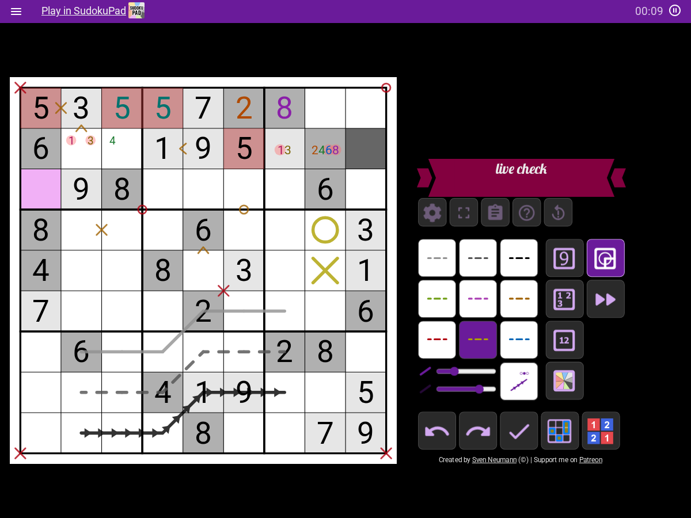
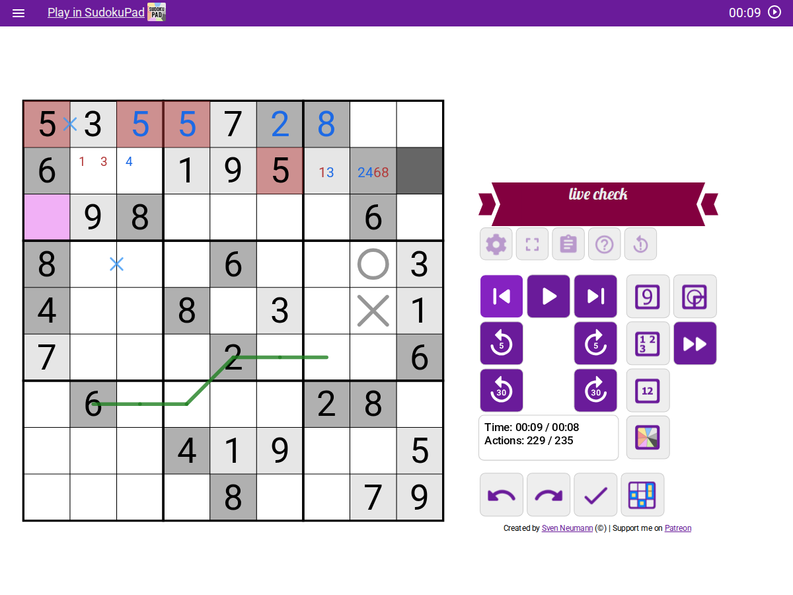
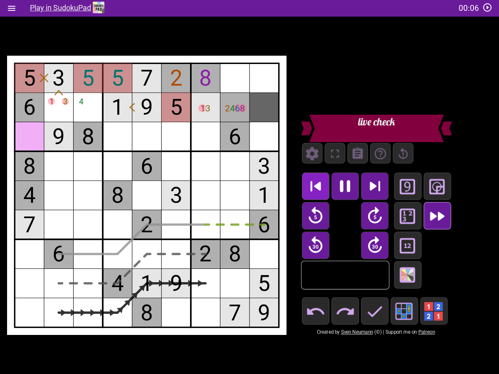
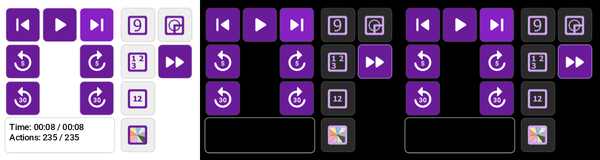
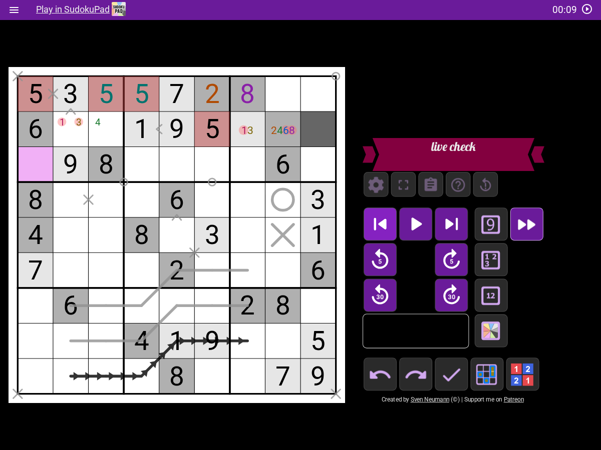

# Replay files under every script

Ticket #98. Question: what breaks when a saved replay is played with these scripts? Run on sudokupad.app, which the saved file records as version 0.612.0
(headless Chromium, Playwright), using the puzzle in `live/puzzle-url.txt`. Nothing was fetched from SudokuBank.

**Result: one script breakage, one SudokuPad limitation worth a ruling, nothing else.** With the pen tool setting on, every case
ends on the recorded grid, with no page error, no stall and the same played action list as a page with no scripts. Dark Page makes the replay tool's readout unreadable (#100). A replay played with
SudokuPad's pen tool setting off loses pen colors, with every script or none (#101).

## What was read

- `tool-replay.js` (the replay tool: its Play button is `Puzzle.replayPlay` at speed 10, the other buttons are `jumpTo`) and
  `feature-replaysave.js` (the file: `{"format":"replay_v1.0","puzzle":…,"replay":…}`, saved by the "Replay Save/Load"
  dialog, loaded by `loadPayload` into `puzzle.loadProgress`, which plays the actions at speed -1).
- `Puzzle.replayPlay`, `Puzzle.replayLength`, `Replay.decode`, `App.loadReplay` and `Puzzle.logReplayAct`, read from the
  running page.

## Method

`docs/research/sudokupad-replay-files.mjs` (`record`, then `play`). All input is real mouse and keyboard except the
selection of a cell and the replay tool's Play and jump calls, which use `Framework.app.select` and `ToolReplay.tool`.

**The recording** (`replay-files/recorded.replay`, 235 actions, 8.65 s long, all five scripts installed): five entered digits,
two of them in conflict; corner and centre marks; two cell colors; Color by Digit pressed, undone and pressed again; one
line on each of pen pages 1, 2 and 3 with a bend; edge marks (X, arrows, circle) and grid-corner marks, outer corners
included; a cell circle and cross; a page 2 line erased with a middle click, the erase undone, and erased again. Digit
Color and Dark Page have no action of their own: they are on, at their defaults, and the digits, marks and outer
grid-corner marks give them something to paint. The recorded grid (`recorded-grid.json`) holds every cell's stored values, every
pen element's computed style and box, every `svg text`'s computed fill, and the action list.

**Playing**, in a fresh browser context per case, the scripts injected at `DOMContentLoaded` (as `@run-at document-idle`):

1. **load**: the file through the dialog's own "Load File" (a file chooser), as a player opens a shared file; done when the
   action list holds all 235 actions and nothing is playing.
2. **normal speed**: the replay tool rewound to its start (entering the tool leaves its clock at the end, which an earlier
   version of this run missed, #98's Codex pass), then `ToolReplay.tool.play(-1, 1)`, sampled every 100 ms until paused. The
   tool must be seen playing, and the action count must climb through intermediate values.
3. **play button**: rewound, then the tool's own Play button (speed 10), sampled the same way.
4. **by buttons**: the tool's own buttons: start, +5 s until the end, -5 s twice, end.
5. **by action**: `jumpTo` every action's time in order (235 jumps), then back from the end every seventh action, then
   start, then end (271 jumps in all). Each landing is checked to hold the actions up to that time.

**Cases**, each of the five steps: all five scripts; each script alone (Pen Tool Extras, Color by Digit, Digit Color, Dark
Page, No Tab Letters); none. Three more cases ran with SudokuPad's "Enable Pen Tool" setting off (all, none, Pen Tool
Extras alone). That is 7 + 3 = 10 cases; the other seven had the setting on.

**Checks** at the end of each step: stored values of all 81 cells equal the recording; the pen elements' computed styles
and boxes; every `svg text`'s fill; the action list (a digest) against the recording and against the "none" case's;
page errors and `console.error` per phase (only the console errors of the blocked tracker hosts are ignored); whether the
tool reached paused.

## Results

| Case | Stored grid | Page errors | Stall | Pen drawing equals the recording | Digit fills equal the recording |
| --- | --- | --- | --- | --- | --- |
| all five | equal in all 5 steps | 0 | none | yes | yes |
| Pen Tool Extras alone | equal | 0 | none | yes | no, same as "none" |
| Color by Digit alone | equal | 0 | none | no, same as "none" | no (43 texts, see below) |
| Digit Color alone | equal | 0 | none | no, same as "none" | no (differs from "none" in fill) |
| Dark Page alone | equal | 0 | none | no, same as "none" | no, same as "none" |
| No Tab Letters alone | equal | 0 | none | no, same as "none" | no, same as "none" |
| none | equal | 0 | none | no | no |
| all, pen tool setting off | **18 cells differ** | 0 | none | no | yes |
| Pen Tool Extras alone, setting off | **18 cells differ** | 0 | none | no | no |
| none, setting off | **18 cells differ** | 0 | none | no | no |

"No" in the last two columns is the expected difference when the script that draws it is absent, so the useful reading is
each case against "none" (the same page with no script):

- **Pen drawing.** With Pen Tool Extras the drawing is the recording's, element for element, in all five steps. Without
  it, the 34 recorded pen elements become 29: the same marks drawn with SudokuPad's own pen colors, and 10 of them with
  stroke and fill both `none`, the page 2 and page 3 lines, as I read them, that `docs/pen-tool-extras.md` says draw with no color
  without the script (the expected result of the ticket). The five cases without Pen Tool Extras draw identically (one digest), so no other script changes the
  drawing.

  

- **Digit fills.** The all-scripts case equals the recording. Digit Color alone differs from "none" in fill with the same
  number of texts (39). Dark Page alone and No Tab Letters alone match "none". Color by Digit alone and all-scripts hold 43
  `svg text` where the others hold 39: the four numbers in the Color by Digit button's own icon, which my selector counts
  (checked: `#control-colorbydigit svg text` is 4). I did not compare Color by Digit alone's fills further than that count.
- **Cell colors from Color by Digit.** The press, its undo and the second press are in the file as group start, colour, group end and undo
  actions, and every case ends with the same stored cell colors as the recording.
- **Reaction to played actions.** Every case in every step holds the same 235-action list as the "none" case, compared by
  digest, the three pen-tool-setting-off cases included: no script adds or rewrites an action while a replay plays. That list is
  not identical to the recording: the recording holds bare `ds` where the played list holds `ds:r1c3`, `ds:r1c4` and so on
  (deselect names its cell), the same with no script. Auto mode's replay behavior is #97's, and was not tried.
- **Stalls and speed.** Every normal-speed and Play-button run reached `replay-paused`, was seen playing, and climbed through
  16 to 51 distinct action counts on the way: normal speed took about 9.2 s for the 8.65 s recording and the Play button
  (speed 10) about 1.8 s, in every case. Every landing of the by-action step held at least the actions up to its time and at
  most one more (an action with a zero gap shares its time). The file load took about 0.6 s in every case.
  
- **A baseline oddity, not filed.** After a normal-speed play ends, SudokuPad's own readout can lag the last actions: with no
  script it read "Time: 00:09 / 00:08, Actions: 229 / 235" while the stored grid and action list were complete. The by-buttons
  step ends on 235 / 235. It is the tool's timer ticking every 50 ms with no final refresh; no script is involved.
- **Page errors.** None, in any phase of any case, including the file load, the 271 jumps and a replay played with the pen
  tool setting off.

## Breakages

### 1. Dark Page: the replay tool's readout is black on black (#100)

The replay tool's "Time … / Actions …" box is the `::after` of `.controls-input`, colored `rgb(0, 0, 0)`. Dark Page paints
the page black and recolors the footer text but not this, so the readout cannot be read in the screenshots of the Dark Page and
all-scripts cases (the computed color was read on a page with Dark Page only). From left: no scripts, Dark Page alone, all scripts.

### 2. A replay played with the pen tool setting off loses pen colors (#101)

Not a script's doing: the same 18 cells differ with all scripts, with Pen Tool Extras alone and with none. Every pen value
whose color is not 1 is stored as color 1 (`1b` becomes `11`, `k6` becomes `k1`, `u7` becomes `u1`): the colors played show that the `pc:` action
that selects the color is not applied while the setting is off. Page 3 lines keep their color, because Pen Tool Extras sends it
inside the action (`pe:1n`). A page 2 line then draws as a solid page 1 line (the gray one in row 7 below), which is wrong
drawing that a reader of a shared replay sees from this repo's page 2 pens. Filed as `needs-info` because the fixes
differ in who owns the setting.

## Not covered

- A real Tampermonkey install and crackingthecryptic.com (as always). Chromium headless only.
- One injection time (`DOMContentLoaded`); the other two live-test times were not repeated, since the file load starts from
  a fresh page.
- Auto mode (#97). A Color by Digit press made while the replay tool is open, and any script setting changed during a
  replay.
- Dropping the file onto the page: the dialog's "Load File" and the drop handler both call `handleLoadFromFile`, and only
  the dialog was driven.
- The by-action step checks the count of actions at each landing, not the picture; the picture is compared at the end of
  each step, and the half-way picture of a normal-speed play is one screenshot per case in the harness output.
- The recorded `replay-files/recorded-grid.json` holds the puzzle's givens and the player's entries only; it holds no
  solution.

## Rerun

`node docs/research/sudokupad-replay-files.mjs record play` from the repo root re-records and plays all ten cases;
`play all none:nopen` plays chosen ones (the "none" case is needed for the action-list comparison). `:nopen` after a case turns the pen tool setting off. Results go to
`.scratch/replay-results.json` and screenshots to `.scratch/replay-shots/`. A rerun overwrites `recorded.replay` and
the recorded grid; both depend on the puzzle in `live/puzzle-url.txt` and on the SudokuPad version of the day (0.612.0 here).
